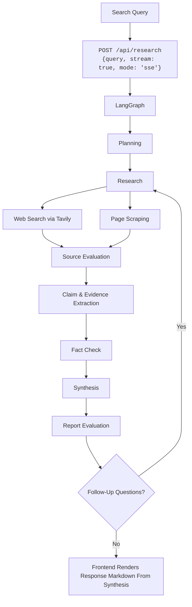

# Research Agent

An AI researching agent built with *LangChain.js* that researches the web and answers with sources.

[**Live Demo**](https://karl.hackclub.app/)


## How it Works



## Tech Stack

### Frontend

- **Next.js**
- **React**

### Backend

- **TypeScript**
- **LangChain.js & LangGraph**: A framework for building AI agents using nodes that fulfill different purposes like searching the web or fact-checking.
- **OpenAI-compatible API**: For LLM tasks, a OpenAI-compatible API endpoint specified in the .env file gets called. For this demo, Hackclub AI was used.

## Getting Started

Clone this repository:

```bash
git clone https://github.com/RaptorAssassin/research-agent.git
cd research-agent
```

Make sure you got *Node.js* and *pnpm* installed:

```bash
node -v #v24.0.0 or higher
pnpm -v #v11.25.0 or higher
```

Copy the `.env.example` file and set an OpenAI-compatible API endpoint (base URL + API key) and the models you want to use. For the exact details, refer to the docs of the API you're using.

```bash
cp .env.example .env.local
```

Install dependencies:

```bash
pnpm install
```

Run the development server:

```bash
pnpm dev
```

View the app at [http://localhost:3000](http://localhost:3000/).

## Future Updates

Ollama support is in the works.
